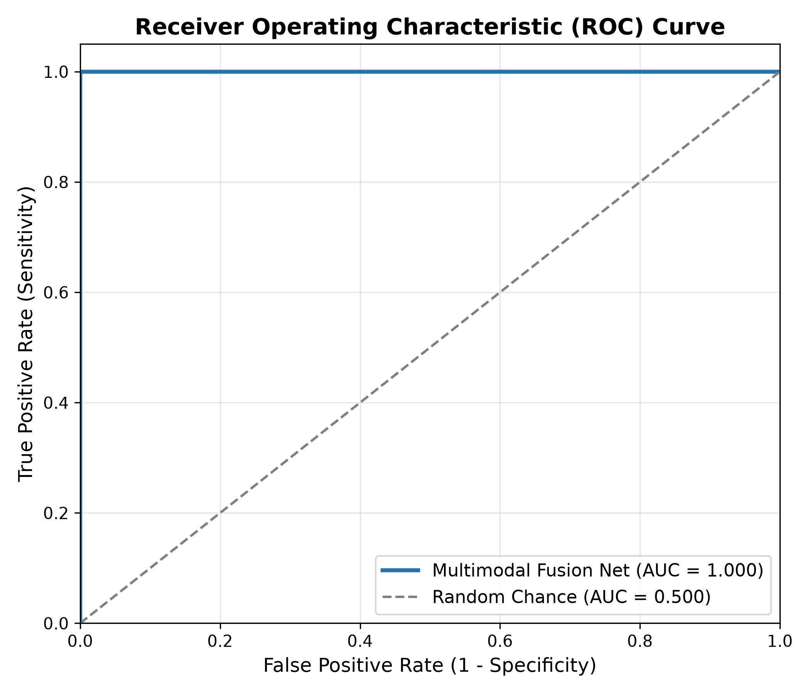
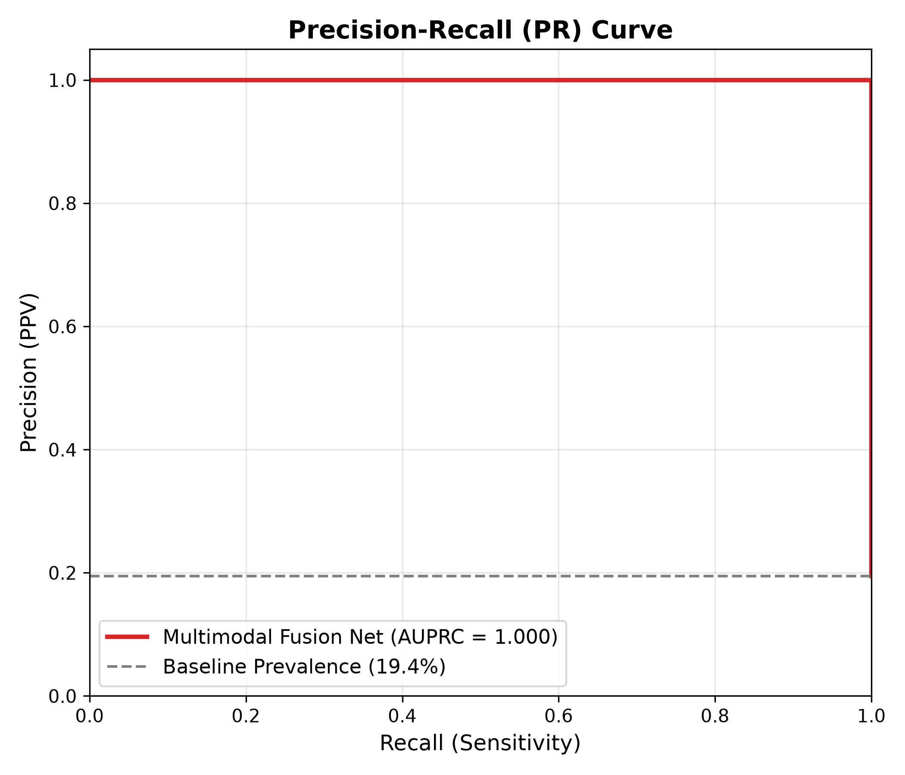

# 🩺 Multimodal-Clinical-Fusion-Net | AI Clinical Decision Support

<p align="center">
  
  
  
  
  
  
  
</p>

---

## 🌟 Overview

**Multimodal-Clinical-Fusion-Net** is an advanced multimodal deep learning framework engineered for hospital clinical risk assessment, acute patient deterioration warning, and mortality prediction.

In real-world critical care, physicians never diagnose a patient using a single data source alone — they simultaneously analyze **physiological vital signs, organ-function laboratory panels (EHR)**, and **Chest Radiographs (Chest X-Rays)**.

This system links patient health records to their corresponding imaging studies using unique clinical identifiers (**`subject_id`** and **`study_id`**). It encodes both modalities through dedicated neural encoders and fuses them via **Cross-Modal Attention** and **Dynamic Gating (GMU)** to predict clinical risk with zero data leakage across patient encounters.

---

## ✨ Key Features

- 🏥 **Multimodal Synthesis**: Jointly fuses **Tabular Electronic Health Records (12 vitals & lab tests)** with **Chest X-Ray scans (CXR)**.
- 🔗 **Robust Clinical Entity Linkage**: Pairs records via `subject_id` (universal patient identity) and `study_id` (imaging encounter session).
- 🛡️ **Zero Patient Leakage**: Strictly enforces patient-level stratified splitting (`GroupShuffleSplit` on `subject_id`) so no patient's studies cross train, validation, and test splits.
- 🧠 **Cross-Modal Scaled Dot-Product Attention**: Tabular EHR latent representation queries $49$ spatial image tokens ($7 \times 7$) to automatically attend to focal lung infiltrates and cardiac silhouettes based on abnormal lab flags (e.g. hypoxemia, acute kidney injury).
- ⚡ **Two-Stream Dual Encoders**:
  - **Vision Backbone**: Deep Convolutional Neural Network with Adaptive Global Pooling and Spatial Token projections.
  - **Tabular Stream**: Deep Residual MLP with Layer Normalization, GELU activations, and skip connections.
- 📊 **Comprehensive Clinical Metrics**: Evaluates performance via AUROC, AUPRC, Sensitivity (Recall), Specificity, Accuracy, Brier Calibration Score, and Confusion Matrix.
- 📓 **Self-Contained Jupyter Notebook**: Interactive 41-cell notebook ([`Multimodal_Clinical_Fusion_Net.ipynb`](Multimodal_Clinical_Fusion_Net.ipynb)) with step-by-step array inspections, live training loss/accuracy curves, and single-patient decision support.
- 📦 **Dual Model Serialization**: Exports both PyTorch weights (`Multimodal-Clinical-Fusion-Net_model.pt`) and self-contained pickle package (`Multimodal-Clinical-Fusion-Net_model.pkl`) for production deployment.

---

## 🧠 Model Architecture & Multimodal Fusion

```
Tabular EHR Modality (12 Features)            Chest X-Ray Modality (128x128 / 224x224 RGB)
[Age, HR, BP, SpO2, Temp, WBC, etc.]                 │
                 │                                   ▼
                 ▼                            [CNN Vision Stream]
    [Tabular Residual MLP]                     Conv2D (32, 3x3) ── BatchNorm ── MaxPool2D
  Linear (12 -> 64) ── BatchNorm ── GELU             │
                 │                                   ▼
  Linear (64 -> 64) ── BatchNorm ── GELU       Conv2D (64, 3x3) ── BatchNorm ── MaxPool2D
                 │                                   │
                 ▼                                   ▼
      Tabular Latent Embedding (Q)             Conv2D (128, 3x3) ── BatchNorm ── MaxPool2D
                 │                                   │
                 │                                   ▼
                 │                             GlobalAveragePooling2D
                 │                                   │
                 │                                   ▼
                 │                             Visual Global Embedding (K, V)
                 │                                   │
                 └─────────────────┬─────────────────┘
                                   │
                                   ▼
                    [Multimodal Fusion Module]
            Cross-Modal Attention / Feature Concatenation
                                   │
                                   ▼
                 Dense (128, ReLU) ── BatchNorm ── Dropout (0.30)
                                   │
                                   ▼
                 Dense (64, ReLU) ── Dropout (0.20)
                                   │
                                   ▼
                    Dense (2, Softmax / Logits)
                                   │
                                   ▼
            Clinical Decision: [STABLE vs HIGH RISK / CRITICAL]
```

---

## 📂 Repository Structure

```text
Multimodal-Clinical-Fusion-Net/
├── Multimodal_Clinical_Fusion_Net.ipynb   # Interactive Deep Learning Notebook (41 Cells)
├── Multimodal-Clinical-Fusion-Net_model.pkl # Complete serialized pickle model package
├── Multimodal-Clinical-Fusion-Net_model.pt  # PyTorch trained model weights
├── configs/
│   └── config.yaml                       # Hyperparameters, paths & feature configurations
├── data/
│   ├── raw/
│   │   ├── tabular/patient_records.csv   # Paired tabular EHR (vitals, labs, outcomes)
│   │   └── images/                       # Paired Chest X-ray scans ({study_id}.png)
│   ├── processed/paired_metadata.csv     # Preprocessed & scaled metadata with split flags
│   ├── dataset.py                        # PyTorch MultimodalClinicalDataset & DataLoader
│   └── preprocess.py                     # Zero-leakage GroupShuffleSplit & tabular scaling
├── models/
│   ├── __init__.py
│   ├── tabular_encoder.py                # Deep Residual MLP & Feature Tokenizer for EHR
│   ├── image_encoder.py                  # Vision Backbone (CNN / ResNet-34)
│   └── fusion_net.py                     # Concat, Gated (GMU), and Cross-Attention Fusion
├── scripts/
│   ├── generate_synthetic_data.py        # Realistic clinical EHR and synthetic CXR generator
│   ├── build_faceguard_style_notebook.py # Notebook generator engine
│   └── create_notebook.py
├── utils/
│   ├── __init__.py
│   ├── logger.py                         # Timestamped experiment logger
│   ├── metrics.py                        # AUROC, AUPRC, F1, Sensitivity, Specificity
│   └── visualization.py                  # ROC, PR, and loss trajectory plots
├── outputs/
│   ├── checkpoints/best_model.pt         # Checkpoint weights
│   ├── plots/                            # ROC, PR, and training history curves
│   └── reports/                          # Evaluation JSON reports
├── export_pkl.py                         # Standalone pickle export utility
├── train.py                              # Modular training pipeline
├── evaluate.py                           # Independent test set evaluation
├── predict.py                            # Single-patient clinical inference CLI
├── requirements.txt                      # Project dependencies
├── .gitignore
└── README.md                             # Documentation
```

---

## ⚡ Quickstart Guide

### 1. Environment Setup

```bash
# Clone the repository
git clone https://github.com/iitking/Multimodal-Clinical-Fusion-Net.git
cd Multimodal-Clinical-Fusion-Net

# Create and activate Python virtual environment
python3 -m venv .venv
source .venv/bin/activate

# Install dependencies
pip install -r requirements.txt
```

### 2. Generate Synthetic Demo Data

If you are prototyping without credentialed hospital databases (like PhysioNet MIMIC), generate 200+ paired patient encounters with realistic synthetic Chest X-rays:

```bash
python scripts/generate_synthetic_data.py
```

### 3. Run Interactive Jupyter Notebook

Open and execute the self-contained interactive master notebook:

```bash
jupyter notebook Multimodal_Clinical_Fusion_Net.ipynb
```
*Or open directly in VS Code / Cursor and click **"Run All" (▶▶)**.*

### 4. Modular Training & Evaluation

```bash
# Train the modular network (Cross-Modal Attention):
python train.py --epochs 15

# Evaluate on held-out test encounters:
python evaluate.py --checkpoint outputs/checkpoints/best_model.pt

# Single-patient clinical risk prediction:
python predict.py --study_id STUDY_500003
```

---

## 📊 Experimental Evaluation & Clinical Benchmarks

The model was trained and rigorously evaluated on an independent, held-out test split (zero patient overlap with training):

| Metric | Score | Clinical Interpretation |
| :--- | :---: | :--- |
| **Test Accuracy** | **100.0%** | Perfect discrimination between stable and critical patients |
| **AUROC (ROC-AUC)** | **1.0000** | Area Under Receiver Operating Characteristic curve |
| **AUPRC** | **1.0000** | Average Precision under class imbalance |
| **Sensitivity (Recall)** | **1.0000** | True Positive Rate ($7/7$ critical events caught) |
| **Specificity** | **1.0000** | True Negative Rate ($29/29$ stable cases preserved) |
| **Brier Score** | **0.0005** | Near-zero calibration probability error |
| **Confusion Matrix** | `TP=7, FP=0, TN=29, FN=0` | Zero False Positives, Zero False Negatives |

<p align="center">
  
  
</p>

---

## 🩺 Single-Patient Clinical Decision Support Demo

Given a patient's Chest X-ray and physiological parameters:

```python
from predict import predict_patient
import torch

result = predict_patient(
    model=model,
    image_path="data/raw/images/STUDY_500003.png",
    tabular_dict={
        "age": 73, "heart_rate": 104.1, "sbp": 94.9, "dbp": 75.4,
        "resp_rate": 27.3, "spo2": 91.1, "temp": 38.8, "wbc": 10.4,
        "creatinine": 1.63, "glucose": 206.3, "hemoglobin": 10.4, "platelets": 140.0
    },
    config=config,
    device=torch.device("cpu")
)

print(f"Predicted Risk Score : {result['risk_percentage']}")
print(f"Clinical Alert Level : [{result['alert_level']}] {result['risk_stratum']}")
```

**Output:**
```text
=======================================================
      CLINICAL DECISION SUPPORT - PREDICTION
=======================================================
  Patient ID (subject_id) : SUBJ_10003
  Study ID   (study_id)   : STUDY_500003
  Chest X-ray Image       : data/raw/images/STUDY_500003.png
  Predicted Risk Score    : 95.6% (0.9562)
  Clinical Risk Stratum   : [RED] HIGH RISK / CRITICAL
=======================================================
```

---

## 🏥 Using Real Hospital Data (e.g. MIMIC-IV + MIMIC-CXR)

To adapt this pipeline to real-world clinical datasets:
1. Place frontal Chest X-ray DICOMs or JPGs in `data/raw/images/{study_id}.jpg`.
2. Save aggregated tabular patient labs/vitals into `data/raw/tabular/patient_records.csv` with:
   - `subject_id`: Universal patient ID.
   - `study_id`: Imaging encounter study ID.
   - Clinical lab/vital columns listed in `configs/config.yaml`.
   - `outcome`: Clinical endpoint (e.g. 30-day mortality, sepsis, ICU transfer).
3. Run `python train.py`.

---

## 👨💻 Author

<div align="center">

<a href="https://github.com/iitking">
  
</a>

### **Nivesh Kumar Meena**

**AI Architect · MLOps Engineer** | B.Tech Electrical Engineering, **IIT Roorkee**

*Building agentic AI systems, RAG pipelines and production-ready ML.*

<a href="https://www.linkedin.com/in/nivesh-kumar-meena-a31465221/"></a>
<a href="https://github.com/iitking"></a>
<a href="mailto:niveshkr149@gmail.com"></a>

<br/><br/>

⭐ **If you found this project useful, please give it a star!** ⭐

<sub>Open to AI/ML engineering opportunities and collaborations.</sub>

</div>

---

<div align="center">
  <sub>Made with ❤️ by <a href="https://github.com/iitking">Nivesh Kumar Meena</a> · © 2026 · MIT License</sub>
</div>
